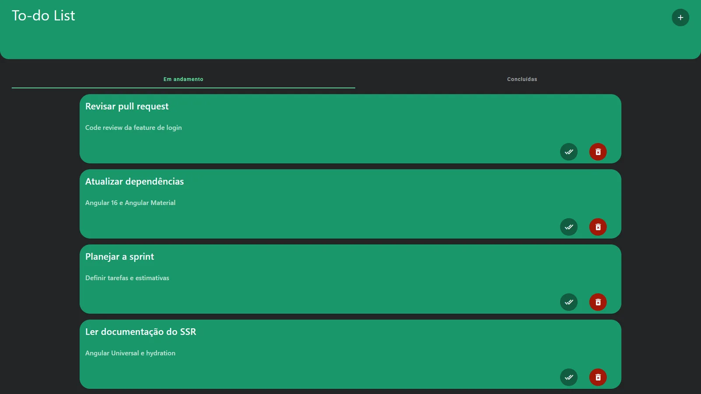
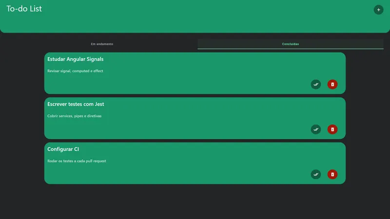
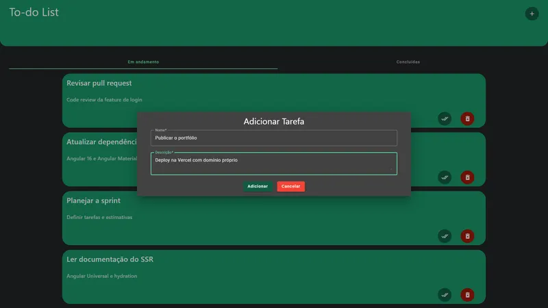
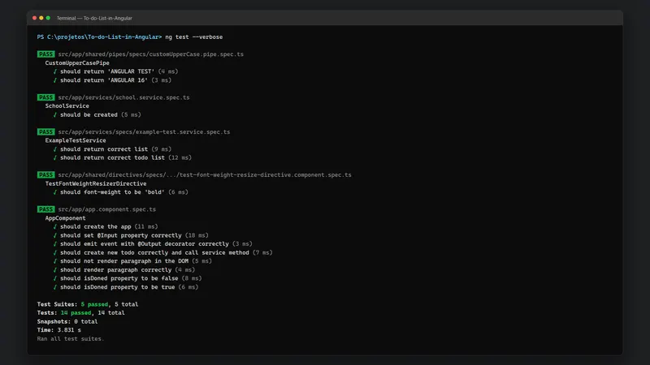

# To-do List em Angular com Signals e Testes

Gerenciador de tarefas em Angular 16 com Signals, Angular Material e 14 testes com Jest.

<p align="center">
  
</p>

---

## Sumário

- [Visão geral](#visão-geral)
- [Telas](#telas)
- [Stack e versões](#stack-e-versões)
- [Estrutura do projeto](#estrutura-do-projeto)
- [Primeiros passos](#primeiros-passos)
- [Scripts](#scripts)
- [Autor](#autor)

---

## Visão geral

Aplicação de tarefas para praticar os recursos mais novos do Angular: estado com Signals, componentes standalone, comunicação com @Input e @Output, pipe e diretiva personalizados, SSR e persistência no localStorage. As tarefas ficam separadas em abas (em andamento e concluídas) e são criadas por um diálogo do Angular Material. O projeto tem testes unitários com Jest para componente, serviços, pipe e diretiva.

Principais funcionalidades:

- Estado com Angular Signals
- Pipe e diretiva personalizados
- 14 testes unitários com Jest
- SSR e dados no localStorage

Concluído em 11/2024.

---

## Telas

Todas as telas usam dados fictícios.

<table>
  <tr>
    <td width="50%"><br><sub>Tarefas concluídas</sub></td>
    <td width="50%"><br><sub>Diálogo para adicionar tarefa</sub></td>
  </tr>
  <tr>
    <td width="50%"><br><sub>Testes com Jest passando no terminal</sub></td>
  </tr>
</table>

---

## Stack e versões

| Categoria | Tecnologia | Versão |
| --- | --- | --- |
| Linguagem | TypeScript | 5.0 |
| Framework | Angular | 16.0 |
| Build | Angular CLI | 16.0 |
| Componentes | Angular Material | 16.0 |
| Reatividade | RxJS | 7.8 |
| Testes | Jest + Jasmine + Karma | 29.7 / 4.6 / 6.4 |
| Qualidade | Prettier | 3.3 |

As versões exatas estão no `package.json`.

---

## Estrutura do projeto

```
src/
  app/
    components/
    models/
    services/
    shared/
    app.component.html
    app.component.scss
    app.component.spec.ts
    app.component.ts
    app.config.server.ts
    app.config.ts
  assets/
  favicon.ico
  index.html
  main.server.ts
  main.ts
  server.ts
  styles.scss
```

---

## Primeiros passos

### Pré-requisitos

- Node.js 16.14 ou mais recente
- npm

### Instalação

```bash
git clone https://github.com/marcospsdev/To-do-List-in-Angular.git
cd To-do-List-in-Angular
npm install
npm start                 # http://localhost:4200
```

---

## Scripts

| Comando | Descrição |
| --- | --- |
| `npm start` | Servidor de desenvolvimento em http://localhost:4200 |
| `npm run build` | Build de produção em `dist/` |
| `npm run watch` | Build em modo watch |
| `npm test` | Testes unitários |

---

## Autor

**Marcos Paulo** · Desenvolvedor Full-Stack

- LinkedIn: [in/marcospsdev](https://www.linkedin.com/in/marcospsdev)
- GitHub: [@marcospsdev](https://github.com/marcospsdev)
